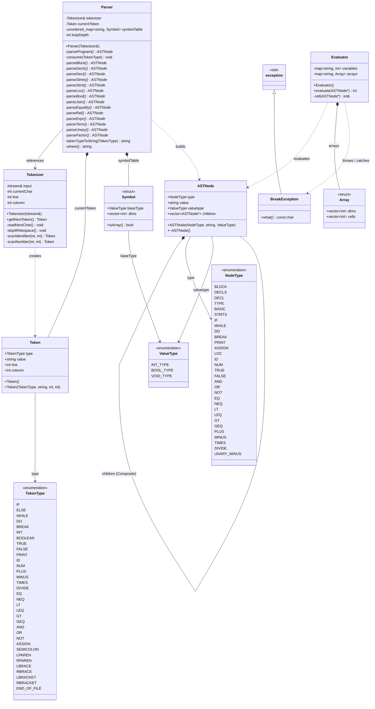
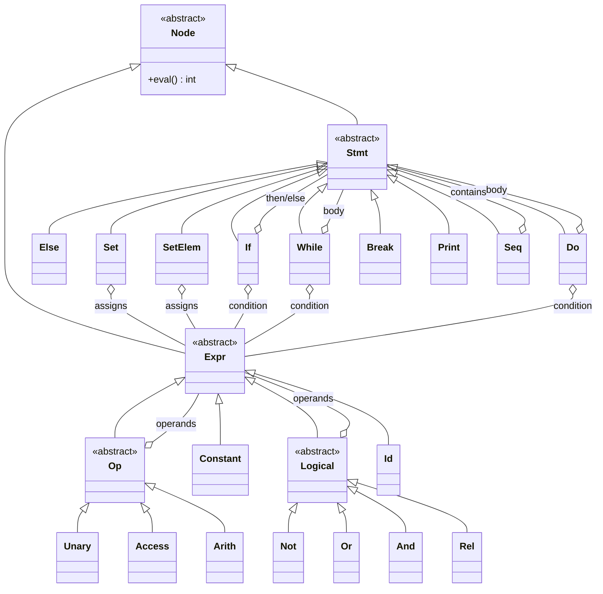
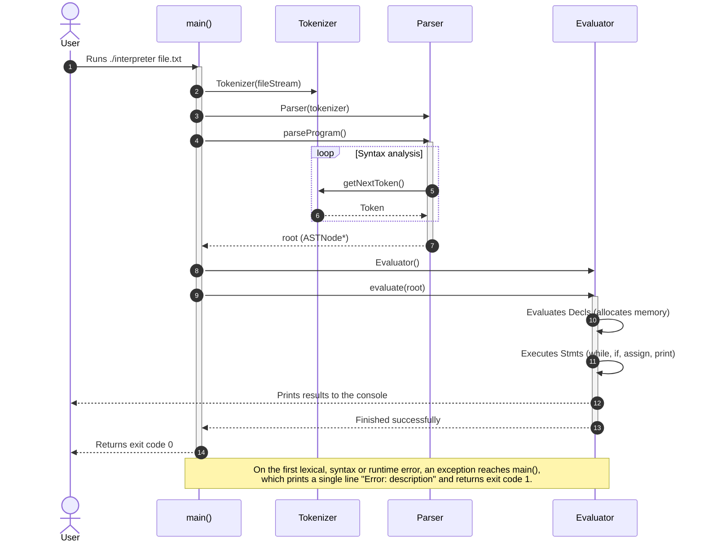

# Interpreter UML Design
**Author:** Pietro Ravera  

---

## 1. Architecture Overview

The interpreter for the C subset follows the classic translate-then-execute pipeline:

1. **Lexical Analysis (Scanner / Tokenizer):**
   - The `Tokenizer` class reads a source `std::istream` and produces `Token` objects one at a time.
   - Each token is classified by the `TokenType` enumeration and stores its position in the source text (line and column), so error messages can point to the exact location.

2. **Syntax Analysis and Static Semantics (Parser):**
   - The `Parser` class is a *recursive-descent parser* that checks the source against the language's context-free grammar.
   - It performs *type checking* on arithmetic, boolean and relational expressions.
   - It manages the symbol table (`symbolTable`) to ensure every identifier is declared at most once and is only used after its declaration.
   - It builds the abstract syntax tree made of `ASTNode` objects.

3. **Runtime Evaluation and Execution (Evaluator):**
   - The `Evaluator` class walks and executes the abstract syntax tree (`ASTNode`).
   - It holds the single memory space for scalar variables and arrays (`variables` and `arrays`).
   - It implements short-circuit evaluation for the logical operators `&&` and `||`.
   - It performs runtime checks on array bounds (*bounds checking*) and division by zero, raising exceptions that `main()` reports as `Error: <description>`.
   - It handles control-flow interruptions (`break`) through the dedicated `BreakException`.

---

## 2. UML Class Diagram (System Structure)

A rendered version of this diagram is available in [uml_diagram.svg](uml_diagram.svg) (PlantUML source: [uml_diagram.puml](uml_diagram.puml)).

---

## 3. Conceptual AST Diagram (Interpreter & Composite Patterns)

The logical hierarchy of the AST nodes follows the **Composite** and **Interpreter** patterns. In the code, this hierarchy is not implemented as separate C++ classes: every node is an `ASTNode`, and its role is given by the `NodeType` field. The `Evaluator` dispatches on that field, which plays the part of the virtual `eval()` method. The table after the diagram maps each conceptual class to its `NodeType` values.

| Conceptual class | `NodeType` in the code | Notes |
|---|---|---|
| `Seq` | `BLOCK`, `DECLS`, `STMTS` | `BLOCK` has two children: the declarations and the statements |
| `If` / `Else` | `IF` | 2 children (`if`) or 3 children (`if ... else`) |
| `While` | `WHILE` | children: condition, body |
| `Do` | `DO` | children: body, condition |
| `Set` | `ASSIGN` with an `ID` target | scalar assignment |
| `SetElem` | `ASSIGN` with a `LOC` target | array element assignment |
| `Break` | `BREAK` | raises `BreakException` |
| `Print` | `PRINT` | prints the value of its only child |
| `Arith` | `PLUS`, `MINUS`, `TIMES`, `DIVIDE` | |
| `Unary` | `UNARY_MINUS` | |
| `Access` | `LOC` | one `LOC` per index: `a[i][j]` is `LOC(LOC(ID a, i), j)` |
| `Constant` | `NUM`, `TRUE`, `FALSE` | |
| `Id` | `ID` | |
| `Not`, `And`, `Or` | `NOT`, `AND`, `OR` | `AND` and `OR` short-circuit |
| `Rel` | `EQ`, `NEQ`, `LT`, `LEQ`, `GT`, `GEQ` | |
| *(declarations)* | `DECL`, `TYPE`, `BASIC` | `TYPE` wraps the base type once per array dimension |

---

## 4. Detailed Component Description

### `Token` and `TokenType`
* **Role:** The smallest lexical unit found in the source.
* **Attributes:**
  - `type`: Syntactic category of the token (keywords such as `IF`, `WHILE`, operators such as `PLUS`, `ASSIGN`, separators, identifiers `ID`, numbers `NUM`, etc.).
  - `value`: Literal text of the lexeme (e.g. a variable name or a numeric value).
  - `line`, `column`: Coordinates used to locate errors in diagnostic messages.

### `Tokenizer`
* **Role:** Lexical analyzer.
* **Main methods:**
  - `getNextToken()`: Consumes characters from the `input` stream, skipping whitespace and single-line comments (`//`), and returns the next valid token or `END_OF_FILE`. Invalid characters (e.g. `%`, `^`) raise a lexical error.
  - `scanIdentifier()`: Recognizes identifiers and reserved words (`if`, `else`, `while`, `do`, `break`, `int`, `boolean`, `true`, `false`, `print`).
  - `scanNumber()`: Recognizes decimal integer constants and rejects literals that do not fit in an `int`.

### `Parser`
* **Role:** Recursive-descent syntax analyzer with static validation of types and declarations.
* **Responsibilities:**
  - Implements the grammar productions of the language; left-recursive rules are written as loops to keep left associativity.
  - Checks that every variable is declared before it is used.
  - Forbids declaring the same identifier more than once (`symbolTable`).
  - Checks type consistency in assignments and in arithmetic (`+`, `-`, `*`, `/`), relational (`<`, `<=`, `>`, `>=`), equality (`==`, `!=`) and boolean (`&&`, `||`, `!`) expressions.
  - Recognizes array declarations such as `int[10] v;` and indexing such as `v[i]`.
  - Checks that every `break` statement is inside a loop (`loopDepth > 0`).

### `ASTNode`
* **Role:** Node of the Abstract Syntax Tree (AST).
* **Attributes:**
  - `type`: Kind of syntactic construct the node represents (`NodeType`).
  - `value`: Associated value (variable name, operator string or literal).
  - `valuetype`: Semantic data type (`INT_TYPE`, `BOOL_TYPE`, `VOID_TYPE`).
  - `children`: Vector of pointers to the child subtrees (Composite pattern). The destructor frees the whole subtree.

### `Evaluator`
* **Role:** Engine that interprets and executes the AST.
* **Responsibilities:**
  - Evaluates $\langle decls \rangle$ first and then $\langle stmts \rangle$ in each block.
  - Manages a single global memory space for scalar variables (`variables`) and arrays, including multidimensional ones (`arrays`, stored row-major in `Array::cells`).
  - Executes `if-else` conditionally and `while` / `do-while` iteratively.
  - Exits loops early when a `BreakException` is raised.
  - Uses short-circuit evaluation for the logical operators `&&` and `||`.
  - Detects and reports runtime errors: division by zero and array indices outside the declared bounds.

---

## 5. Execution Sequence Diagram

